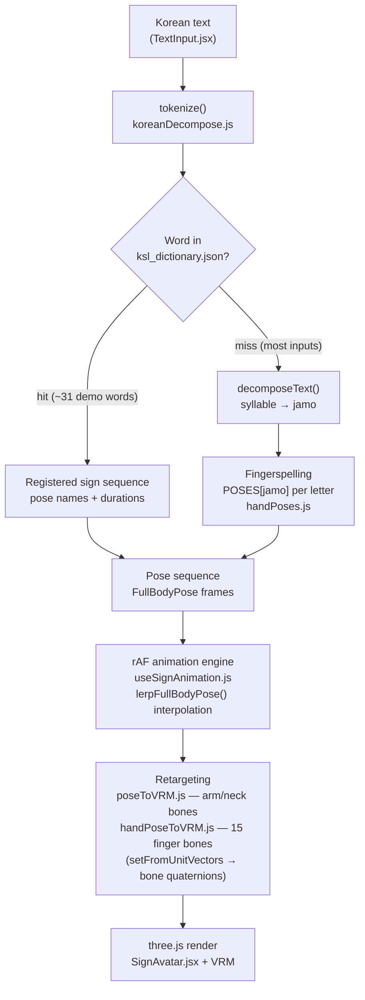

# Korean Sign Language Translator

A web app that turns Korean text into a 3D Korean Sign Language (KSL) animation, driven by a VRM character. No backend — it ships as static assets and can be dropped onto Vercel or any static host.

> Personal/study project. **Fingerspelling covers every Hangul jamo** (19 initials including the double consonants ㄲㄸㅃㅆㅉ, and all 21 vowels including the compound ones). The **word-level dictionary is a small demo set of ~31 approximate entries** — hand-tuned by eye, *not* linguistically verified KSL. Using this for real KSL education would need review by a qualified expert.

## Getting started

```bash
npm install
npm run dev
```

Vite serves on its default port (usually 5173). Use `npm run build` for a production build and `npm run preview` to preview it locally.

### Setting up the avatar

The avatar is rendered from a VRM 1.0 model. Because the file is large (often 10–15 MB), it is **not committed to the repo** — `.gitignore` excludes `public/avatars/*.vrm`. Place your own model at:

```
public/avatars/default.vrm
```

The app loads it lazily on first render. Recommended way to obtain one:

1. Install [VRoid Studio](https://vroid.com/en/studio) (free, macOS / Windows).
2. Customize a character and export as **VRM 1.0**.
3. Drop the exported `.vrm` into `public/avatars/default.vrm`.

A different file path can be wired up by editing `DEFAULT_VRM_URL` in `src/utils/vrmLoader.js`.

## How it works

1. Type Korean text and press **번역** ("Translate").
2. Words present in the dictionary (`src/data/ksl_dictionary.json`) are played as their registered sign sequence.
3. Words that are not registered fall back to **fingerspelling** — they are decomposed into Hangul jamo and signed letter by letter. In practice this is the path most inputs take, since the dictionary is a ~31-word demo set.
4. Playback speed, pause/resume, and a progress bar are wired up in the player UI.
5. The 3D viewport supports **mouse drag to rotate** and **wheel to zoom** (OrbitControls), which is useful for inspecting hand shapes from different angles.

Example inputs: `안녕하세요`, `감사합니다`, `사랑해`, `좋아요`, `1`, `2`, `3`.

### Pipeline



The retargeting step is direction-driven: each bone's rest direction (its child's local offset) is rotated onto the target direction taken from the pose data, in the parent bone's local frame.

## Tech stack

- React 18 + Vite 5
- Three.js + [@pixiv/three-vrm](https://github.com/pixiv/three-vrm) (VRM 1.0 / 0.x avatar)
- Tailwind CSS

## Project layout

```
src/
├─ App.jsx                    Header + avatar/player/input layout
├─ components/
│  ├─ SignAvatar.jsx          Three.js scene, VRM loader, RAF loop, OrbitControls,
│  │                          auto camera fit based on VRM bone positions
│  ├─ AnimationPlayer.jsx     Playback controls
│  └─ TextInput.jsx           Input form with example chips
├─ hooks/
│  └─ useSignAnimation.js     RAF-driven sequence player, frame interpolation
├─ utils/
│  ├─ vrmLoader.js            GLTFLoader + VRMLoaderPlugin wrapper, default VRM URL
│  ├─ poseToVRM.js            Maps full-body world coordinates → humanoid bone
│  │                          rotations (upper arm, lower arm, neck)
│  ├─ handPoseToVRM.js        Maps 21-point landmark deltas → finger bone rotations
│  │                          (Thumb / Index / Middle / Ring / Little ×
│  │                          Proximal / Intermediate / Distal)
│  ├─ handPoses.js            Hand shapes (21 landmarks) and upper-body pose presets
│  ├─ poseFormat.js           Pose interpolation helpers
│  ├─ koreanDecompose.js      Hangul jamo decomposition (Unicode arithmetic)
│  └─ __tests__/              Vitest suites (decomposition, pose data, retargeting, sequence building)
└─ data/
   └─ ksl_dictionary.json     Sign dictionary (word → pose sequence, ~31 demo entries)

public/
└─ avatars/
   └─ default.vrm             Local-only VRM model (gitignored)
```

### Coordinate systems

**Hand pose data** is anchored at the wrist with this convention:

- `+Y` — direction the fingers point
- `+X` — direction of the pinky
- `+Z` — toward the viewer (also the bend-toward-palm direction)

Landmark indices follow the MediaPipe hand model (0 = wrist, 1–4 = thumb, 5–8 = index, 9–12 = middle, 13–16 = ring, 17–20 = pinky).

**Side naming** — the pose presets use `left`/`right` from the **viewer's** point of view, while VRM humanoid bones use `left`/`right` from the **character's own** point of view (these are mirror opposites). The conversion in `SignAvatar.jsx` swaps sides when calling into `applyHandPoseToVRM`, and `poseToVRM.js` does the same swap for arm bones. Keep this in mind when adding new poses.

## Adding new signs

To add a word, append an entry to `src/data/ksl_dictionary.json`:

```json
"사랑해": {
  "description": "I love you",
  "sequence": [
    { "pose": "open", "duration": 250 },
    { "pose": "ily",  "duration": 500 },
    { "pose": "open", "duration": 250 }
  ]
}
```

Each `pose` value must match a key in the `POSES` object in `src/utils/handPoses.js`. If you need a new hand shape, add a 21-landmark coordinate array to the same file and register it in `POSES`. The test suite checks that every `pose` name used by the dictionary actually exists in `POSES`, so a typo fails `npm run test`.

## Testing

[Vitest](https://vitest.dev) runs against the same Vite config, so no extra setup is needed.

```bash
npm run test         # single run
npm run test:watch   # watch mode
```

Tests live in `src/utils/__tests__/` and cover the parts that are pure logic:

| File | What it covers |
| --- | --- |
| `koreanDecompose.test.js` | Syllable → jamo decomposition: plain syllables, double consonants (ㄲㄸㅃㅆㅉ), compound vowels (ㅘㅙㅚㅝㅞㅟㅢ), finals and consonant clusters, non-Hangul passthrough, tokenization |
| `handPoses.test.js` | Data integrity: every jamo that decomposition can emit has a pose entry (clusters excepted, see Limitations), each pose matches the `FullBodyPose` shape (7 body joints + 21 landmarks per hand), and every pose name referenced by `ksl_dictionary.json` exists |
| `handPoseToVRM.test.js` | Retargeting math against a mock humanoid bone tree — three.js runs headless, so no VRM asset or DOM is needed. Asserts finger bones end up pointing along the landmark direction (with the palm-bend Z flip), that a rotated wrist carries the fingers with it, that quaternions stay unit-length, and that the guard clauses no-op on missing bones/landmarks |
| `signSequence.test.js` | Text → frame sequence: dictionary hits, word pauses, total duration, and that keys like `_comment` / `constructor` are never treated as dictionary words |

## Limitations

- **Wrist orientation is implicit.** Pose data only specifies wrist *position*; the wrist's rotation is derived from the elbow→wrist direction. Some chest-front presets (`chestR`, `chestBoth`, `thumbsR`) are tuned so fingers point upward in the camera's view; other presets may show fingers at unfamiliar angles. This is a structural limitation that future iterations could solve by adding explicit hand orientation to the data model.
- **Approximate finger axis mapping.** The landmark coordinate system and the VRM hand bone's local axes differ between models. Currently the Z component of finger bend direction is flipped to align bend direction; a per-VRM calibration of palm-normal could improve accuracy.
- **No facial expressions, mouth shapes, or non-manual signals.** VRM blendshapes exist but are not yet wired up.
- **The word dictionary is a demo set, not a vocabulary.** `ksl_dictionary.json` holds ~31 entries (greetings, pronouns, a few nouns, digits 1–5). They are approximations authored by eye, not verified against a KSL reference, and several of them reuse generic hand shapes. Treat them as placeholders showing the dictionary mechanism works — not as correct signs. Everything outside that list is fingerspelled.
- **Fingerspelling is complete but still approximate.** All 19 initial consonants, 21 vowels, and the simple finals have a pose, so any Hangul input can be spelled out — but the hand shapes themselves are hand-tuned approximations and will diverge from the real 한글 지문자 chart. Compound vowels in particular (ㅐㅒㅔㅖㅘㅙㅚㅝㅞㅟㅢ) currently reuse their base-vowel poses.
- **Consonant clusters (겹받침) are skipped.** `ㄳ ㄵ ㄶ ㄺ ㄻ ㄼ ㄽ ㄾ ㄿ ㅀ ㅄ` decompose to a single jamo with no pose entry, so the fingerspelling fallback drops them silently (`닭` signs as ㄷ + ㅏ). Splitting clusters into their two component consonants would fix this.
- **Avatar height assumption.** Camera fit reads the head and hips bone positions and the right-arm bone length, so swapping in a different VRM should adapt automatically. If the framing looks off, check that the VRM has its standard humanoid bones populated.
